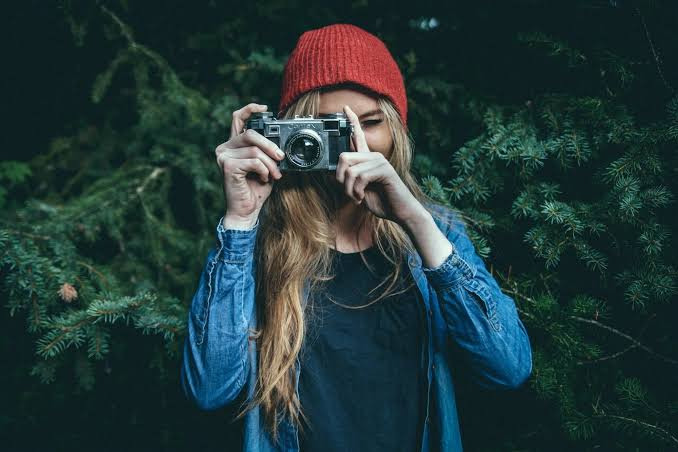
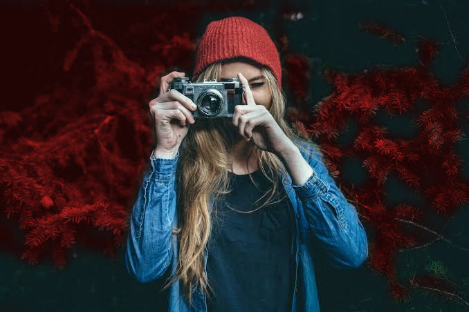
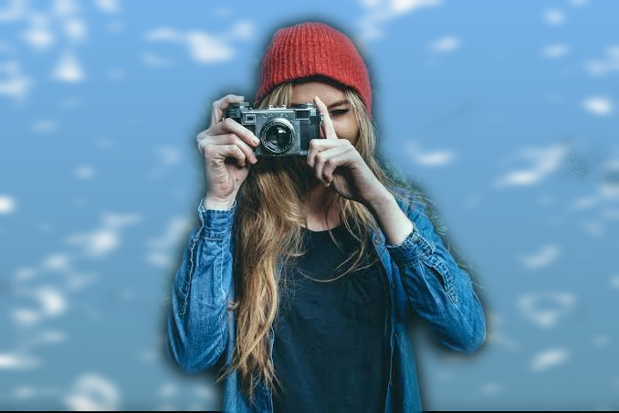

# SAM Image Segmentation

Image segmentation and region editing with Meta's **Segment Anything Model (SAM)**. Segment every object in an image automatically, recolor a single region while keeping its natural shading, or swap a region with a different image.

## Results

| Original | Recolored region | Swapped region |
|---|---|---|
|  |  |  |

## What's inside

| Script | What it does |
|---|---|
| `segment_sam.py` | Automatically finds and segments every distinct region in an image and paints each with a solid colour |
| `recolor_region.py` | Changes the colour of one region (picked by clicking a point) while preserving its shading, folds and texture |
| `region_swap.py` | Replaces one region with content from another image, with feathered edges for a natural blend |

## How it works

- **Segmentation:** SAM's automatic mask generator (ViT-B model) proposes candidate regions. Largest regions are painted first so big areas stay solid, and each pixel is coloured only once.
- **Recolor:** the image is converted to HSV. Only hue and saturation are replaced inside the mask; brightness (Value) is untouched, so shadows and highlights stay in place.
- **Swap:** the replacement image is resized to the region's bounding box and blended in using a Gaussian-feathered mask.

## Setup

```bash
pip install torch torchvision opencv-python numpy
pip install git+https://github.com/facebookresearch/segment-anything.git
```

Download the SAM ViT-B checkpoint (about 375 MB) and place it in the repo's root folder, next to the scripts:

https://dl.fbaipublicfiles.com/segment_anything/sam_vit_b_01ec64.pth

The model file is not included in this repository because of its size. It runs on CPU (a GPU is optional).

## Usage

Run all commands from the repo's root folder.

**Segment a whole image**
```bash
python segment_sam.py --input images/Human.jpg --outdir results
```
Output: `Human_sam_segmented.png` (can take 1 to 3 minutes on CPU)

**Recolor one region** (`--point X Y` is a pixel inside the region you want)
```bash
python recolor_region.py --input images/Human.jpg --mode sam --point 91 330 --color red --outdir results
```
`--color` accepts a name (red, blue, green, yellow, orange, purple, pink, black, white, gray, brown) or a `B,G,R` value such as `40,120,200`. Repeat `--point` to merge several parts into one region.

**Swap one region with another image**
```bash
python region_swap.py --input images/Human.jpg --replacement images/clouds_sky.png --mode sam --point 300 600 --outdir results
```

## Notes

- The coordinates above are examples. Use any pixel that falls inside the region you want to edit.
- `--mode label` (reuse a pre-made label map) is also available, but it works best with raw, unnormalized label masks. If results look wrong, use `--mode sam`.

## Tech stack

Python, PyTorch, OpenCV, NumPy, Segment Anything (Meta AI)

## Author

Sumbal Naseer
